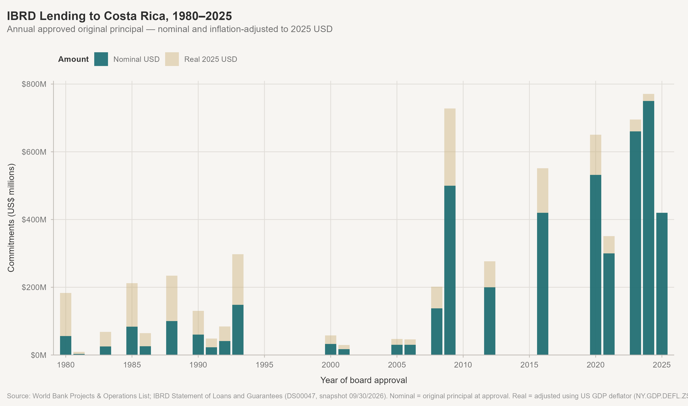
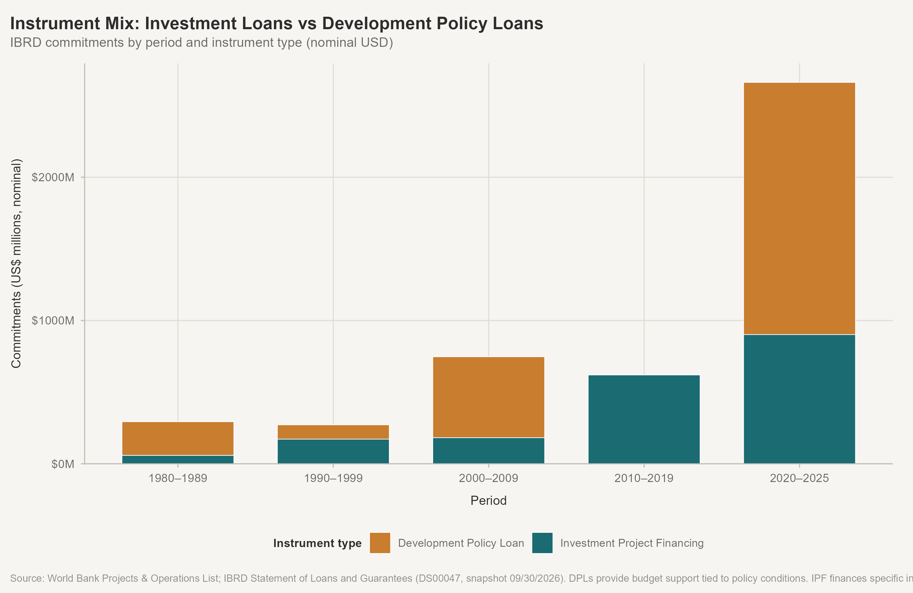
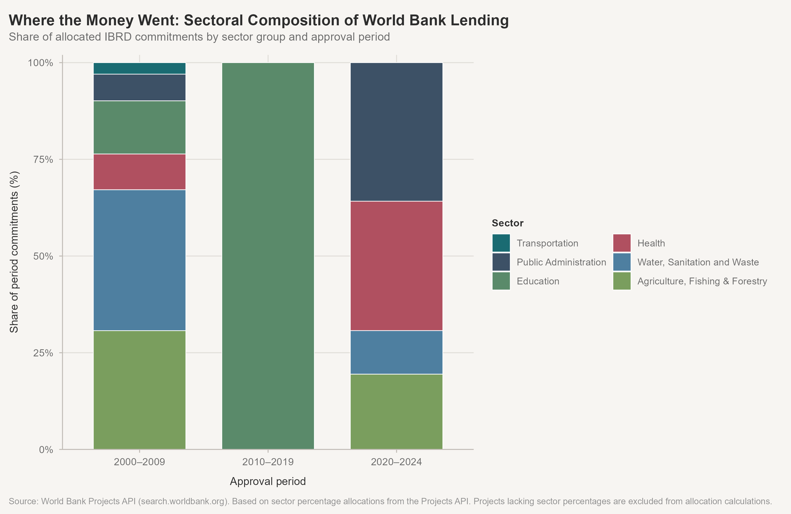
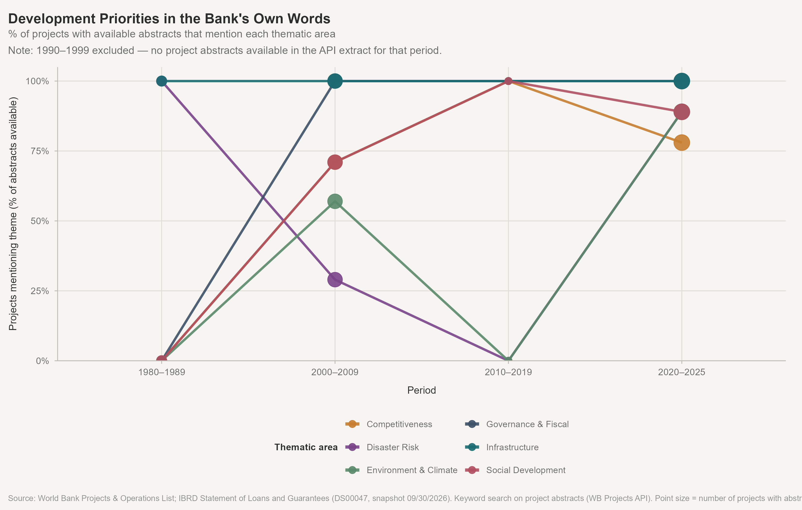

# Tico-nomics

**The World Bank Group in Costa Rica: Development Finance, Shifting Priorities, and 45 Years of an Evolving Relationship**

🔗 [Explore the Project](https://johbry17.github.io/Tico-nomics/)

An exploratory, descriptive analysis of how the World Bank Group's financing relationship with Costa Rica changed from 1980 to 2025 — in scale, instruments, stated priorities, and institutional character.

## Contents

- [The Central Question](#the-central-question)
- [Published Site](#published-site)
- [Key Findings](#key-findings)
- [Research Design](#research-design)
- [Institutional Scope](#institutional-scope)
- [Data Sources](#data-sources)
- [Principal Figures](#principal-figures)
- [Repository Structure](#repository-structure)
- [Rebuilding the Analysis](#rebuilding-the-analysis)
- [Data Limitations](#data-limitations)
- [Tools and Technologies](#tools-and-technologies)
- [Licenses](#licenses)
- [Author](#author)

---

## The central question

How did the World Bank Group's financing relationship with Costa Rica evolve from 1980 to 2025, and what does that evolution reveal about changing development priorities and the broader practice of international development finance?

The analysis is descriptive. It documents patterns in a 45-year lending and investment record. It does not establish that World Bank financing caused changes in Costa Rica's economic or social outcomes.

---

## Published site

[https://johbry17.github.io/Tico-nomics/](https://johbry17.github.io/Tico-nomics/)

| Page | Contents |
|---|---|
| [Overview](https://johbry17.github.io/Tico-nomics/reports/overview.html) | The story — what happened across four decades |
| [Analysis](https://johbry17.github.io/Tico-nomics/reports/analysis.html) | Full tables, charts, and evidence |
| [Data](https://johbry17.github.io/Tico-nomics/reports/data-dictionary.html) | Variable definitions and source documentation |
| [Methods](https://johbry17.github.io/Tico-nomics/reports/methodology.html) | Research design, data decisions, and reproducibility |

---

## Key findings

1. **Policy-based lending has repeatedly shaped the portfolio, but its prominence has varied considerably.** It accounted for approximately 70% of 1980s commitments, remained present in the 1990s and 2000s, disappeared entirely in the 2010s, and returned at scale in the 2020s. Six DPLs accounted for approximately 66% of 2020–2025 commitments, including three Fiscal and Decarbonization DPLs (2020–2023).

2. **In real 2025 dollars, earlier lending was larger than nominal figures suggest.** The 1980s operations (~$294M nominal) represent roughly $772M in 2025 dollars. The 2009 $500M DPL was approximately $728M in real terms.

3. **Abstract language analysis is limited by sparse coverage.** No project abstracts are available for the 1990s in the API extract. The 1980s and 2010s each have only 1–2 abstracts. Environment and climate keywords appear in available abstracts from the 2000s and 2020s, but were not detected in the two available 1980s abstracts. Sparse and uneven coverage limits comparisons across periods.

4. **IFC's Costa Rica portfolio is concentrated in financial services**, with Reventazon HPP ($100M, projected board date 2012) as the largest non-financial investment.

---


## Research design

The study examines the World Bank Group's financing relationship with Costa Rica from 1980 through 2025. IBRD lending forms the core analysis, with complementary examinations of IFC private-sector investments and MIGA political-risk guarantees.

| Element | Definition |
|---|---|
| Study period | 1980–2025 |
| Geographic scope | Costa Rica |
| Project universe | 115 projects identified in the World Bank Projects & Operations List |
| Primary analytical sample | 35 in-scope IBRD projects |
| Primary financial measure | Original principal approved, in nominal and constant 2025 US dollars |
| Institutional coverage | IBRD (core), IFC (companion), MIGA (historical survey) |
| Instrument analysis | Development policy financing and investment project financing |
| Sector analysis | IBRD commitments with available sector allocation data |
| Thematic analysis | Keyword-based examination of available IBRD project abstracts |
| Economic context | GDP, GDP growth, income inequality, and life expectancy |

The analysis combines descriptive financial trends, instrument and sector classifications, and qualitative examination of project documentation. Inflation-adjusted values use the US GDP deflator to express historical commitments in constant 2025 dollars.

The 115-project universe is not equivalent to the final IBRD analytical sample. Institutional coverage, project eligibility, and source availability determine which records enter each component of the analysis. IFC and MIGA are examined separately because their financial measures represent different forms of development finance and are not directly comparable with IBRD lending.

---

## Institutional scope

| Institution | Role | Covered? |
|---|---|---|
| **IBRD** | Sovereign loans to middle-income governments | Core analysis |
| **IFC** | Private-sector investment | Companion analysis |
| **MIGA** | Political-risk guarantees | Historical survey |
| **IDA** | Concessional financing for lower-income countries | Historical note only (CR graduated [FY1962](https://ida.worldbank.org/en/about/borrowing-countries/ida-graduates)) |

These institutions' financial measures are NOT comparable and are never summed.

---

## Data sources

| File | Source | Description |
|---|---|---|
| `ibrd_statement_of_loans_and_guarantees_*.csv` | [World Bank IBRD Statement DS00047](https://financesone.worldbank.org/ibrd-statement-of-loans-and-guarantees-latest-available-snapshot/DS00047) | 68 loan records, 59 unique project IDs; snapshot 09/30/2026 |
| `Projects_and_Operations_List.xlsx` | [World Bank Projects Portal](https://projects.worldbank.org/en/projects-operations/projects-summary) | 115 Costa Rica projects; snapshot 11/01/2026 |
| `world_bank_costa_rica*.json` | [WB Search API V2](https://search.worldbank.org/api/v2/projects?format=json&countrycode=CR&rows=100&fl=id,project_name,totalamt,sector1,sector2,sector3,boardapprovaldate,closingdate,status,project_abstract) | 72-project extract (supplementary) |
| `IFC_Projects_Costa Rica.xlsx` | [IFC Project Disclosures](https://disclosures.ifc.org) | 40 records, 30 unique projects |
| `World_Bank_Group_Guarantees_MIGA-projects.csv` | [MIGA Projects](https://www.miga.org/projects) | 12 records, 10 unique projects |
| WDI indicators | [World Bank API](https://api.worldbank.org/v2/) | GDP, Gini, life expectancy, GDP growth |

Raw source files are retained unchanged in `data/raw/`. US GDP deflator (NY.GDP.DEFL.ZS) used to calculate real 2025 dollar values from [World Bank WDI](https://api.worldbank.org/v2/country/US/indicator/NY.GDP.DEFL.ZS).

---


## Principal figures

### IBRD commitments over time



*Annual IBRD commitments were uneven across the study period, with a pronounced concentration in 2020–2025. Expressing historical commitments in constant 2025 dollars makes earlier lending episodes more comparable.*

### Changing composition of lending instruments



*The balance between investment project financing and development policy lending shifted considerably across periods. Policy-based financing, prominent in the 1980s, regained substantial importance in the 2020s.*

### Sectoral composition



*Sector allocations show the distribution of commitments across public administration, education, infrastructure, and other areas. Coverage is incomplete: allocations are available for 22 of 35 projects, and individual projects may span multiple sectors.*

### Development priorities in project abstracts



*Project abstracts provide a complementary view of institutional priorities through the language used to describe operations. Coverage varies substantially across periods: no abstracts are available for the 1990s, and small samples limit comparisons in several other periods.*

---

## Repository structure

```
Tico-nomics/
├── _quarto.yml
├── README.md
│
├── data/
│   ├── raw/              # Unmodified source files
│   ├── processed/        # Cleaned analytical datasets
│   ├── derived/          # Summary tables
│   └── manual/           # Instrument classification overrides
│
├── R/
│   ├── functions.R       # Theme, palette, shared helpers
│   ├── 00_setup.R        # Packages and paths
│   ├── 01_import_sources.R
│   ├── 02_prepare_wdi.R  # Requires internet
│   ├── 03_reconcile_projects.R
│   ├── 04_prepare_ibrd.R
│   ├── 05_prepare_ifc.R
│   ├── 06_prepare_miga.R
│   ├── 07_analysis.R
│   ├── 08_visualizations.R
│   └── 09_validation.R
│
├── reports/              # Four public-facing Quarto pages
│   ├── overview.qmd
│   ├── analysis.qmd
│   ├── data-dictionary.qmd
│   ├── methodology.qmd
│   ├── custom-light.scss
│   └── custom-dark.scss
│
├── figures/              # Generated figures (PNG + SVG)
├── scripts/              # Build utility scripts
├── archive/              # Phase 0 and Phase 1 historical scripts
│
└── docs/                 # Rendered Quarto site
```

---

## Rebuilding the analysis

Run R scripts in order from the project root (R >= 4.4):

```r
source("R/00_setup.R")
source("R/01_import_sources.R")    # source inspection, no outputs
source("R/02_prepare_wdi.R")       # requires internet connection
source("R/03_reconcile_projects.R")
source("R/04_prepare_ibrd.R")
source("R/05_prepare_ifc.R")
source("R/06_prepare_miga.R")
source("R/07_analysis.R")
source("R/08_visualizations.R")
source("R/09_validation.R")        # all 55 checks should pass
```

Render the site (Quarto >= 1.4):

```bash
quarto render
```

Rendering the Quarto site does not independently execute the full analytical pipeline. The R scripts must be run first to regenerate the processed datasets, derived summaries, and figures.

**R packages:** `here`, `readr`, `readxl`, `dplyr`, `tidyr`, `purrr`, `stringr`, `lubridate`, `jsonlite`, `httr2`, `ggplot2`, `scales`, `patchwork`, `svglite`, `knitr`, `kableExtra`, `tidytext`, `forcats`, `glue`

---

## Data limitations

- The World Bank Projects API V2 returned only 72 of 115 Costa Rica projects. The Projects & Operations List (115 records) is the authoritative project universe for this analysis.
- Sector metadata is available for 22 of 35 in-scope IBRD projects. However, incomplete or missing allocation percentages mean the sector analysis distributes approximately $2.2 billion of the $4.6 billion portfolio across sector groups. The 2020–2025 DPL series largely lacks usable sector allocation data.
- Project abstract analysis is based on 19 available abstracts from 35 in-scope IBRD projects; availability varies substantially by decade.
- Disbursement figures in the IBRD Statement are cumulative snapshot balances (09/30/2026), not annual flows.
- IFC investment dates are projected board dates, not confirmed approvals.
- MIGA gross exposure is maximum potential guarantee liability, not capital transferred.
- The 2025 GDP deflator and Gini values are preliminary; life expectancy is available only through 2024.

---

## Tools and technologies

- **R** — data preparation, analysis, and visualization
- **Quarto** — reproducible web publication
- **ggplot2** — custom figures
- **World Bank Open Data** — primary data sources
- **Git + GitHub** — version control and hosting

---

## Licenses

The source code and scripts in this repository are licensed under the [MIT License](LICENSE-CODE).

Original written content, documentation, and visualizations created for this project are licensed under the [Creative Commons Attribution 4.0 International License (CC BY 4.0)](LICENSE.md). You are free to share and adapt this material, including for commercial purposes, provided appropriate credit is given, a link to the license is included, and changes are indicated.

World Bank Group data, datasets, documentation, and other third-party materials remain subject to their respective terms, licenses, and attribution requirements. They are not relicensed under the terms above.

## Author

Bryan Johns, November 2026  
[bryan.johns@informedwanderer.com](mailto:bryan.johns@informedwanderer.com) | [LinkedIn](https://www.linkedin.com/in/b-johns/) | [GitHub](https://github.com/johbry17) | [Portfolio](https://informedwanderer.com)  
— Fluent in Data. Fluent in Human.
